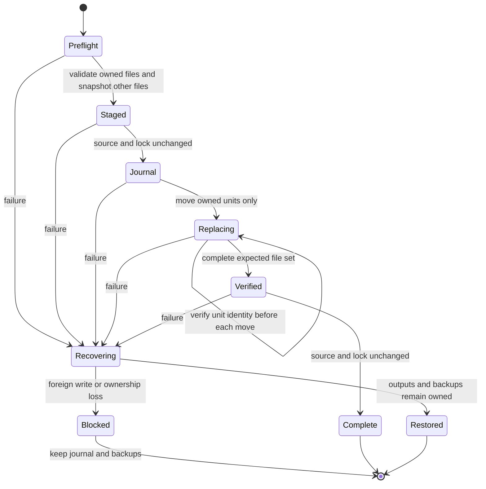

# Repository export ownership

The source exporter currently treats every non-`.git` destination file as generated. This prevents a delivery repository from maintaining its own homepage, installation guide, CI, contribution guidance, and audit documents.

The user explicitly requested independent README maintenance and removal of unnecessary hash restrictions. The accepted release remains immutable: its complete file identities and original README/INSTALL bytes still reconstruct exactly.

## Proposed ownership

- Repository-owned, mutable and outside generated checksums: root `README.md`, root `INSTALL.md`, `AGENTS.md`, `CONTRIBUTING.md`, `SECURITY.md`, `.github/`, repository scripts/tests and ordinary `docs/` files.
- Generated and verified: `skills/` (including agent-readable references and bundled licenses), native manifests, root `LICENSE`, provenance/identity/checksum records, and `docs/generated/`.
- Preserve original release README/INSTALL bytes at `docs/generated/README.md` and `docs/generated/INSTALL.md`. This is a byte archive for exact release reconstruction, not the public installation guide. Source `release-artifact.json`, candidate/version/record identity, runtime bytes and installed versions stay unchanged.
- On the first export, seed root README/INSTALL from the release only if absent. Later exports preserve them, including intentional edits. Legacy registries may relinquish those two root documents without blessing changes to generated runtime content.

## Synchronization and recovery

Preflight verifies all previously generated files except relinquished root README/INSTALL, rejects unknown files in generated-only directories, and snapshots repository-owned files. Stage generated payload and any initial document seeds separately from the checksum/ownership list. Synchronize generated units (`skills`, native metadata folders, `docs/generated`, and generated root files) with the existing lock, journal and backup. Preserve all other paths. Recheck destination/source identities before writing and compare the complete expected final file set before success. Roll back only moved units; retain incomplete-transaction reporting if restoration cannot be verified.

Tests must demonstrate preserved edited root documents and CI/ordinary docs/empty directories; initial seeds excluded from checksums; rejection of changed/missing/unknown runtime and symlink paths; no-op repetition; legacy migration; changed-source/destination failure and rollback; exact restoration of the accepted release from the delivery repository. Source changes require non-author design review before implementation and final independent execution. No upstream adoption, installed-skill removal or model task is part of this change.

## Fixed implementation decisions

Generated root files are exactly `plugin.json`, `LICENSE`, `artifact.json`, `release-artifact.json`, `SHA256SUMS`, and `.devnorm-files.json`. Generated directory units are exactly `skills`, `.claude-plugin`, `.cursor-plugin`, and `docs/generated`. A file outside these units remains repository-owned. A nonempty unknown path inside a generated directory or a conflicting newly owned path stops synchronization. Unknown ordinary directories, including empty ones, are preserved. Traversed symlinks remain rejected before mutation; this change does not relax confinement.

No registry: preserve existing repository-owned files, reject collisions with generated units, and seed root README/INSTALL only if absent. Legacy registry: validate every recorded file except root README/INSTALL and relinquish those two paths. New registry: validate every recorded generated file. Missing root documents stay missing on subsequent exports, rather than being recreated. Same generated payload plus arbitrary repository-owned edits is a no-op. A preexisting `docs/generated` not owned by the old registry is a collision.

Synchronization moves only the generated units above and any first-export document seeds. Before every removal or restoration during rollback, verify the complete affected unit's file bytes, modes, directory set, and backup identity against the preflight/staged snapshot. Repeat this check at each unit boundary. Foreign additions/edits or lost lock stop recovery: preserve destination, backup and journal, and report `export-incomplete`. Newly seeded documents receive the same protection. No filesystem probe can make arbitrary external concurrent writes atomic; the lock coordinates this program's writers and mutation tests cover observed changes at public operation boundaries.

## Model and implementation gates

[RepositoryExport.tla](../verification/export/RepositoryExport.tla) and [configuration](../verification/export/RepositoryExport.cfg) model existing generated units plus an initially absent seed, preflight/staging/journal/replace/verify/complete, controlled restoration or blocked recovery, document edits, foreign unit writes, source drift and lease loss. Properties: preserve foreign content, preserve repository documents, record only an exact verified result, retain journal when moved-unit recovery is blocked. The abstract rollback is atomic; filesystem per-unit interleavings and backup drift require the failure-injection tests above.

TLC command (existing JAR, Java; no installation):

```sh
java -XX:+UseParallelGC -cp "$TLA2TOOLS" tlc2.TLC -workers 1 -metadir /path/to/temporary/states -config verification/export/RepositoryExport.cfg verification/export/RepositoryExport.tla
```

Author run: all four safety invariants, deadlock checking, and eventual termination under weak fairness of program progress PASS. Environment actions can change each unit/document/source/lease only finitely often. Terminal states explicitly stutter. [Raw output](../verification/export/safety-liveness.log). Three expected-invariant-failure runs prove completion, recovery after a seed write, and blocked recovery after a foreign seed edit are reachable. An unsafe-rollback mutant violates `PreserveForeign`. Run `TLA2TOOLS=/path/to/tla2tools.jar python3 -B verification/export/check.py` to reproduce all five checks. Initial sandbox execution failed on TLC's local RMI socket before checking states; the permitted local run passed. This finite model does not prove general OS atomicity or actual client behavior.



The previously supplied `v1.5.0` release remains immutable. The export/checksum layout changes without adopting a new runtime version or replacing installed copies. Root documentation follows the published runtime tag; package validation accepts both legacy and separated-document layouts.

## Success cleanup boundary

Independent implementation review reproduced an additional old failure at journal removal: foreign writes to the backup could be erased by the final cleanup. Success and successful rollback now snapshot the verified remaining temporary content before journal removal, recheck the full tree immediately before each cleanup, and recreate the recovery journal if an observed late change blocks cleanup. The finite model does not model backup bytes or this cleanup interleaving; a real filesystem regression covers that operation boundary. Arbitrary writes inside an individual native filesystem operation remain outside the atomicity claim.
