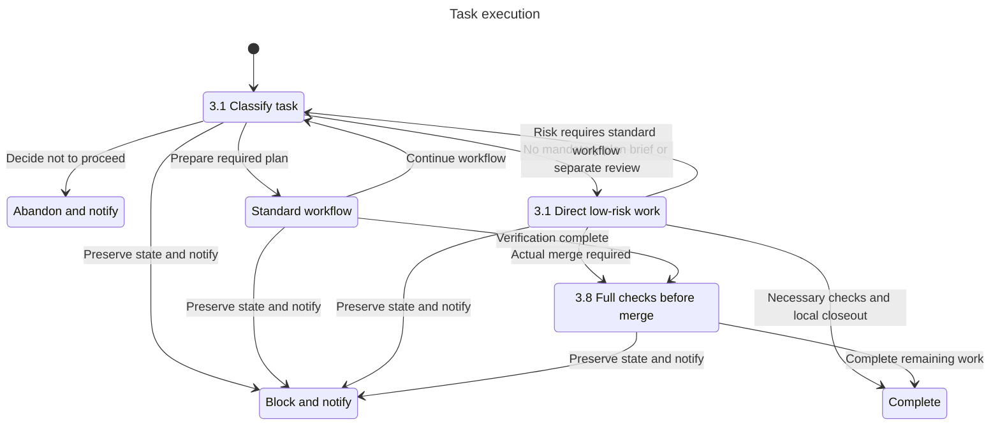

# Development workflow overview

Classify the task under [section 3.1](3-workflow/3.1-task-classification.md#31-task-classification). Other work follows sections 3.2 through 3.8, with full checks before merge. Detailed collaboration, methods, transitions, and periodic-review branches are in the [statecharts](../provenance.md).

For Git operations at any node, read the [Git and GitHub collaboration standard](6-version-control.md) on demand. Verify applicable [Git closeout](3-workflow/3.8-integration-and-completion.md#git-closeout) before reporting completion. This adds no workflow stage.

In this chart, merge covers every project-designated integration-target update, including direct commits or pushes. Ordinary task-branch commits still use quick checks. The chart shows integration routes, without requiring every workspace task to update a target.

Run [periodic review](4-periodic-review.md) at each milestone or agreed interval. Return to the same review after repairs to verify the original findings.

Within implementation and self-check, select small TDD cycles under section 3.5.2; this adds no universal unit-test-first stage.
